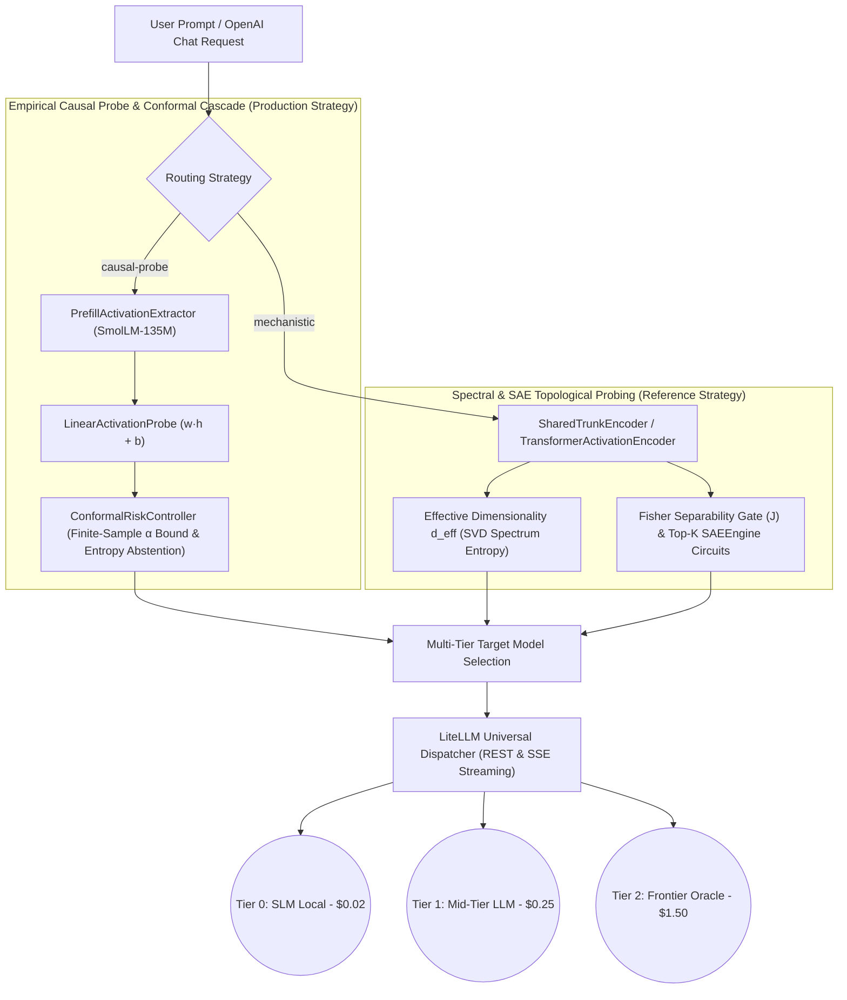

<div align="center">
  <h1>⚡ Mechanistic LLM Router</h1>
  <p><em>White-Box LLM Routing via Encoder-Target Decoupling, Causal Activation Probing, Conformal Risk Control & Sparse Autoencoder Circuit Analysis</em></p>

  [](https://github.com/vfcarida/mechanistic-llm-router/actions/workflows/ci.yml)
  
  
  
  
  
  
</div>

---

> [!NOTE]
> **Architecture & Maturity Governance:** `mechanistic-llm-router` provides two complementary white-box routing paradigms: (1) **`CausalProbeRouter`**, an empirical multi-tier router driven by residual-stream prefill activations from open-weight models (`SmolLM-135M`), `LinearActivationProbe` hyperplanes, `CausalAblationHarness` directional validation, and distribution-free `ConformalRiskController` calibration; and (2) **`MechanisticRouter` (`SimulatedRouter`)**, a spectral and topological reference router combining SVD Effective Dimensionality ($d_{\text{eff}}$), Fisher Discriminant separability ($J$), and Top-K Sparse Autoencoder (`SAEEngine`) circuit extraction. See [`ROADMAP.md`](ROADMAP.md), [`docs/BENCHMARK_REPORT.md`](docs/BENCHMARK_REPORT.md), and [`docs/MECHANISTIC_SPIKE_REPORT.md`](docs/MECHANISTIC_SPIKE_REPORT.md) for verification gates and empirical benchmarks.

---

## 📖 Executive Summary & Core Thesis

Enterprise multi-model AI deployments face a structural trade-off between **inference unit economics** and **epistemic reliability**. Standard black-box LLM routers rely on surface lexical heuristics or opaque external classifiers without distribution-free failure guarantees or causal feature verification.

**Mechanistic LLM Router** bridges **Mechanistic Interpretability** and **Multi-Tier LLM Routing**:
1. **Empirical Causal Probing & Multi-Tier Cascade (`CausalProbeRouter`)**: Extracts prefill residual-stream representations from lightweight local models (`PrefillActivationExtractor`), projects onto a causally validated linear probe (`LinearActivationProbe`), and routes across 2 or 3 model tiers (`SLM-BERTau-Local` $\rightarrow$ `LLM-Mid-Tier` $\rightarrow$ `LLM-Frontier-Oracle`).
2. **Distribution-Free Conformal Risk Control (`ConformalRiskController`)**: Calibrates cascade routing thresholds ($\hat{\lambda}_1(\alpha), \hat{\lambda}_2(\alpha)$) using finite-sample Conformal Risk Control (Angelopoulos et al., *ICLR 2024*) so expected quality degradation relative to the frontier oracle is provably bounded by $\alpha$, complemented by binary Shannon entropy ($H_2(p)$) abstention escalation.
3. **Counterfactual Directional Validation (`CausalAblationHarness`)**: Verifies that a learned activation probe direction $\hat{w}$ is causally load-bearing rather than a spurious surface correlate by comparing orthogonal projection ablation ($h' = h - (h^\top \hat{w})\hat{w}$) against $K=50$ random unit-norm subspace controls.
4. **Topological & Sparse Autoencoder Probing (`MechanisticRouter`)**: Computes Effective Dimensionality ($d_{\text{eff}}$) spectrum entropy over unpooled sequence tokens, Fisher Discriminant separability ($J$), and Top-K Sparse Autoencoder (`SAEEngine`) active feature circuits.

---

## 🧠 Architecture Overview



---

## 🧮 Mathematical Formulations

### 1. Finite-Sample Conformal Risk Control (`probing/conformal.py`)
Given $n$ calibration prompts with complexity probabilities $p_i \in [0, 1]$ and bounded monotone delegation losses $\ell_i(\lambda) \in [0, B]$ relative to the frontier oracle, `ConformalRiskController` selects the supremum threshold $\hat{\lambda}(\alpha)$ satisfying:
$$\frac{n}{n + 1} \hat{R}_n(\lambda) + \frac{B}{n + 1} \le \alpha, \quad \text{where} \quad \hat{R}_n(\lambda) = \frac{1}{n} \sum_{i=1}^n \ell_i(\lambda)$$
guaranteeing $\mathbb{E}[\ell_{n+1}(\hat{\lambda})] \le \alpha$. Boundary ambiguity is quantified via normalized binary Shannon entropy:
$$H_2(p) = -\frac{p \ln p + (1 - p) \ln(1 - p)}{\ln 2} \in [0, 1]$$

### 2. Counterfactual Directional Ablation (`probing/causal_validator.py`)
Given unit normal vector $\hat{w} = w / \|w\|_2$ of a fitted `LinearActivationProbe`, directional projection removes the probe subspace from test activations $X \in \mathbb{R}^{N \times D}$:
$$X_{\text{ablated}} = X - (X \hat{w}) \hat{w}^\top$$
A direction is certified as **Causal** only if the 95% paired bootstrap confidence interval of $\Delta_{\text{target}} - \frac{1}{K}\sum_{k=1}^K \Delta_{\text{ctrl}, k}$ strictly excludes zero ($< 0$).

### 3. Effective Dimensionality ($d_{\text{eff}}$) & Fisher Separability ($J$) (`signals/math_utils.py`)
Calculates singular value spectrum entropy over unpooled sequence activation matrices $A \in \mathbb{R}^{S \times D}$:
$$\sigma = \text{SVD}(A), \quad p_i = \frac{\sigma_i^2}{\sum_j \sigma_j^2}, \quad H = -\sum_{i} p_i \ln(p_i) \implies d_{\text{eff}} = \exp(H)$$
$$J = \frac{1}{D} \sum_{d=1}^{D} \frac{(\mu_{\text{success}, d} - \mu_{\text{failure}, d})^2}{\sigma^2_{\text{success}, d} + \sigma^2_{\text{failure}, d} + \epsilon}$$

---

## 📊 Subsystem Maturity Matrix

See [`ROADMAP.md`](ROADMAP.md) for full engineering governance and milestone specifications.

| Subsystem | Module Path | Status | Verification Gate |
|---|---|---|---|
| **Conformal Risk Control, Mondrian, E-Process, Federated DP & CRDT Sync** | `mechanistic_router.probing.conformal`, `probing.mondrian_conformal`, `probing.eprocess_monitor`, `probing.federated_conformal`, `probing.distributed_conformal` | `Stable` | `tests/test_conformal.py`, `tests/test_round4_horizon.py`, `tests/test_round6_horizon.py`, `tests/test_round8_horizon.py`, `tests/test_round9_horizon.py` |
| **Multi-Layer Residual Stream, Group-Lasso, Bilinear Probe & $\ell_2$ Certifier** | `mechanistic_router.probing.activation_extractor`, `probing.linear_probe`, `probing.bilinear_probe`, `probing.robustness_certifier` | `Stable` | `tests/test_causal_probe_router.py`, `tests/test_next_horizon.py`, `tests/test_round8_horizon.py`, `tests/test_round9_horizon.py` |
| **Contextual Bandit, Primal-Dual Portfolio & Multi-Agent DAG Routing** | `mechanistic_router.routers.linucb_probe`, `routers.portfolio_optimizer`, `routers.dag_router` | `Stable` | `tests/test_round4_horizon.py`, `tests/test_round7_horizon.py`, `tests/test_round8_horizon.py` |
| **Cross-Family Procrustes & Bures-Wasserstein Alignment, Early-Exit, KV-Cache & VLM** | `mechanistic_router.probing.alignment`, `probing.wasserstein_alignment`, `probing.early_exit_probe`, `probing.kv_cache_policy`, `probing.multimodal_probe` | `Stable` | `tests/test_round3_horizon.py`, `tests/test_round7_horizon.py`, `tests/test_round8_horizon.py`, `tests/test_round9_horizon.py`, `tests/test_round10_horizon.py` |
| **Mid-Generation Speculative Cascade Hand-Off** | `mechanistic_router.routers.speculative_cascade`, `gateway.server` | `Stable` | `tests/test_round3_horizon.py`, `tests/test_round4_horizon.py` |
| **Multi-Domain RouterBench & MMLU-Pro Calibration Pack** | `mechanistic_router.evaluation.calibration_pack`, `data/checkpoints/` | `Stable` | `tests/test_next_horizon.py` |
| **Causal Ablation, Steering, SAE Clamping, Safety & Hallucination Gate** | `mechanistic_router.probing.causal_validator`, `probing.activation_steering`, `probing.safety_guardrail`, `probing.hallucination_detector` | `Stable` | `experiments/mechanistic_probe/tests/test_causal_ablation.py`, `tests/test_round5_horizon.py`, `tests/test_round7_horizon.py`, `tests/test_round8_horizon.py`, `tests/test_round10_horizon.py` |
| **Mahalanobis OOD, Kernel MMD Drift & Trajectory Probing** | `mechanistic_router.probing.ood_detector`, `probing.drift_monitor`, `probing.trajectory_probe` | `Stable` | `tests/test_round5_horizon.py`, `tests/test_round6_horizon.py`, `tests/test_round7_horizon.py` |
| **Attention-Head Induction Circuits & Top-K SAE Routing** | `mechanistic_router.probing.attention_probe`, `probing.sae_engine`, `routers.mechanistic` | `Stable` | `tests/test_sae_engine.py`, `tests/test_round3_horizon.py`, `tests/test_round6_horizon.py` |
| **Zero-Leakage Pareto & Doubly Robust Off-Policy Evaluation Harness** | `mechanistic_router.evaluation`, `evaluation.off_policy_evaluator` | `Stable` | `tests/test_benchmark.py`, `tests/test_no_leakage.py`, `tests/test_round10_horizon.py` |
| **OpenAI Gateway (`/v1/chat/completions`, `/v1/embeddings`), Cache, CLI & Audit Ledger** | `mechanistic_router.gateway`, `gateway.activation_cache`, `cli`, `observability.audit_log` | `Stable` | `tests/test_gateway.py`, `tests/test_round5_horizon.py`, `tests/test_round6_horizon.py`, `tests/test_round7_horizon.py`, `tests/test_round8_horizon.py`, `tests/test_round9_horizon.py`, `tests/test_round10_horizon.py` |
| **Real-Model Causal Probe Spike (`SmolLM-135M`)** | `experiments/mechanistic_probe` | `Stable` | `docs/MECHANISTIC_SPIKE_REPORT.md` |

---

## ⚙️ Environment Configuration Reference

Configured via environment variables prefixed with `ROUTER_` or programmatically via [`RouterConfig`](src/mechanistic_router/config.py):

| Parameter / Env Variable | Type | Default | Description |
| :--- | :--- | :--- | :--- |
| `ROUTER_API_KEY` (`api_key`) | `str \| None` | `None` | Authentication secret key for gateway endpoints (returns HTTP 503 if unset). |
| `ROUTER_HOST` (`host`) | `str` | `"0.0.0.0"` | Gateway HTTP server network host binding. |
| `ROUTER_PORT` (`port`) | `int` | `8000` | Gateway HTTP server binding port. |
| `ROUTER_MAX_PROMPT_CHARS` (`max_prompt_chars`) | `int` | `10000` | Maximum character length allowed for incoming user prompts before HTTP 413. |
| `ROUTER_RATE_LIMIT_CAPACITY` (`rate_limit_capacity`) | `float` | `10.0` | Token bucket maximum burst capacity per API key. |
| `ROUTER_RATE_LIMIT_REFILL_RATE` (`rate_limit_refill_rate`) | `float` | `5.0` | Token refill rate per second per API key. |
| `ROUTER_LAMBDA_BUDGET` (`lambda_budget` / `cost_weight`) | `float` | `0.68` | Weight ($\lambda$) balancing normalized inverse cost vs. accuracy. |
| `ROUTER_CONFORMAL_ALPHA` (`conformal_alpha`) | `float` | `0.10` | Target maximum risk bound $\alpha$ for Conformal Risk Control. |
| `ROUTER_FISHER_ALPHA` (`fisher_alpha`) | `float` | `0.30` | Penalty multiplier applied to models failing Fisher competence gating. |
| `ROUTER_HIDDEN_DIM` (`hidden_dim`) | `int` | `128` | Latent representation dimension for shared trunk encoder. |
| `ROUTER_NUM_PREFILL_LAYERS` (`num_prefill_layers` / `num_layers`) | `int` | `6` | Number of simulated prefill layers in shared trunk encoder. |

---

## 🚀 Quickstart & Installation

```bash
# Clone the repository
git clone https://github.com/vfcarida/mechanistic-llm-router.git
cd mechanistic-llm-router

# Create and activate virtual environment (Python 3.10+)
python -m venv .venv
source .venv/bin/activate  # On Windows: .\.venv\Scripts\Activate.ps1

# Install in editable mode with development dependencies
pip install -e ".[dev]"
```

### Calibrated Multi-Tier Causal Probe Routing

```python
import asyncio
import numpy as np
from mechanistic_router.models.pool import MODEL_POOL
from mechanistic_router.probing import LinearActivationProbe, PrefillActivationExtractor
from mechanistic_router.routers.causal_probe import CausalProbeRouter
from mechanistic_router.schemas.routing import RoutingRequest


async def main() -> None:
    extractor = PrefillActivationExtractor(model_name="HuggingFaceTB/SmolLM-135M", device="cpu")
    probe = LinearActivationProbe.load(".cache/checkpoints/causal_probe_demo.npz")

    router = CausalProbeRouter(
        extractor=extractor,
        probe=probe,
        model_pool=MODEL_POOL,
        threshold=0.70,
        mid_threshold=0.30,
        max_uncertainty=0.95,
    )

    decision = await router.route(
        RoutingRequest(prompt="Evaluate cross-border regulatory capital adequacy under Basel III.")
    )
    sig = decision.signals[decision.selected_model]
    print(f"Selected Tier: {decision.selected_model} (${decision.estimated_cost_usd:.2f})")
    print(f"P(Strong):     {sig.extra_metadata['prob_strong']:.4f}")
    print(f"Uncertainty:   {sig.extra_metadata['epistemic_uncertainty']:.4f}")


if __name__ == "__main__":
    asyncio.run(main())
```

---

## 🧪 Testing & Quality Assurance

Every commit is validated against offline unit, property, leakage-isolation, and static analysis gates:

```bash
# Run complete test suite (157 passed, 100% pass rate, 97% coverage)
pytest

# Static type analysis across all source files
mypy src/

# Code quality and formatting checks
ruff check .
ruff format --check .
```

---

## 📄 License, Citation & Bibliography

Released under the [MIT License](LICENSE). See [`CITATION.cff`](CITATION.cff) for academic citation metadata and [`docs/REFERENCES.md`](docs/REFERENCES.md) for the complete scientific and enterprise governance bibliography.

---

<div align="center">
  <small>Designed and architected by <a href="https://github.com/vfcarida">Vinicius Caridá</a>. Implementation and verification accelerated with AI-assisted engineering workflows.</small>
</div>
