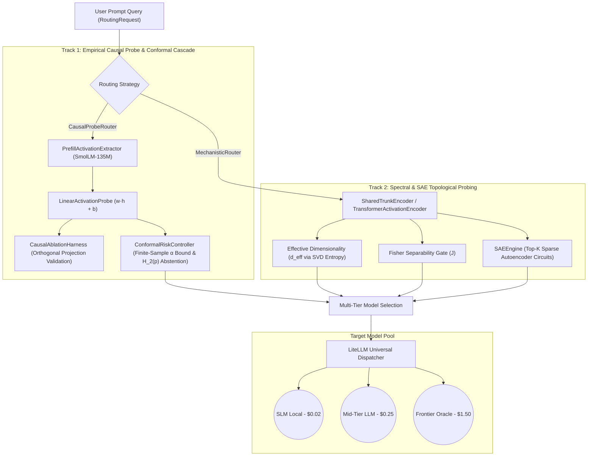

# System Architecture Specification

> [!NOTE]
> **Architecture Dual-Track Design:** `mechanistic-llm-router` implements two strictly zero-leakage routing tracks: (1) **`CausalProbeRouter`**, which extracts real residual-stream activations (`SmolLM-135M`), classifies difficulty via `LinearActivationProbe`, validates directional necessity via `CausalAblationHarness`, and calibrates multi-tier thresholds via `ConformalRiskController`; and (2) **`MechanisticRouter` (`SimulatedRouter`)**, which computes SVD Effective Dimensionality ($d_{\text{eff}}$), simulated Fisher Discriminant separability ($J$), and Top-K Sparse Autoencoder (`SAEEngine`) feature circuits.

---

## Overview

The **Mechanistic LLM Router** implements a two-stage **Encoder-Target Decoupling** framework that inspects prefill representations to allocate queries across multi-tier candidate models (`SLM-BERTau-Local`, `LLM-Mid-Tier`, `LLM-Frontier-Oracle`) without ground-truth label leakage.

---

## Mathematical Formulations

### 1. Finite-Sample Conformal Risk Control (`src/mechanistic_router/probing/conformal.py`)
Given $n$ exchangeable calibration queries with complexity probabilities $p_i \in [0, 1]$ and bounded monotone quality losses $\ell_i(\lambda) \in [0, B]$ relative to the frontier oracle, `ConformalRiskController` selects the supremum threshold $\hat{\lambda}(\alpha)$ satisfying the finite-sample Conformal Risk Control bound (Angelopoulos et al., *ICLR 2024*):
$$\frac{n}{n + 1} \hat{R}_n(\lambda) + \frac{B}{n + 1} \le \alpha, \quad \hat{R}_n(\lambda) = \frac{1}{n} \sum_{i=1}^n \ell_i(\lambda)$$

To guard against boundary ambiguity, normalized binary Shannon entropy quantifies epistemic uncertainty:
$$H_2(p) = -\frac{p \ln p + (1 - p) \ln(1 - p)}{\ln 2} \in [0, 1]$$
When $H_2(p) \ge u_{\max}$, the router abstains from the lower tier and escalates one tier toward the frontier oracle.

### 2. Counterfactual Directional Ablation (`src/mechanistic_router/probing/causal_validator.py`)
Given the unit direction vector $\hat{w} = w / \|w\|_2$ of a fitted `LinearActivationProbe`, directional ablation projects out $\hat{w}$ from test activations $X \in \mathbb{R}^{N \times D}$:
$$X_{\text{ablated}} = X - (X \hat{w}) \hat{w}^\top$$
The causal effect size compares accuracy degradation under $\hat{w}$ ablation against the mean degradation across $K=50$ random unit vectors $\hat{r}_k \in \mathbb{S}^{D-1}$ over $1,000$ paired bootstrap resamples.

### 3. Effective Dimensionality ($d_{\text{eff}}$) (`src/mechanistic_router/signals/math_utils.py`)
Calculates spectrum entropy over the singular value decomposition of unpooled token activation matrices $A \in \mathbb{R}^{S \times D}$:
$$\sigma = \text{SVD}(A), \quad E_i = \sigma_i^2, \quad p_i = \frac{E_i}{\sum_j E_j}$$
$$H = -\sum_{i} p_i \ln(p_i) \implies d_{\text{eff}} = \exp(H)$$

### 4. Fisher Separability ($J$) & Log-Scale Price Selection
Computes the Fisher linear discriminant ratio between success and failure clusters in representation space:
$$J = \frac{1}{D} \sum_{d=1}^{D} \frac{(\mu_{\text{success}, d} - \mu_{\text{failure}, d})^2}{\sigma^2_{\text{success}, d} + \sigma^2_{\text{failure}, d} + \epsilon}$$

Once candidate models pass the competence threshold, log-scale normalization balances unit query costs against capability scores:
$$\text{LogScore}_i = \frac{\ln(\text{Cost}_{\max} / \text{Cost}_i)}{\ln(\text{Cost}_{\max} / \text{Cost}_{\min})}, \quad \text{Score}_i = \lambda_{\text{eff}} \cdot \text{LogScore}_i + (1 - \lambda_{\text{eff}}) \cdot \text{AccNorm}_i$$
