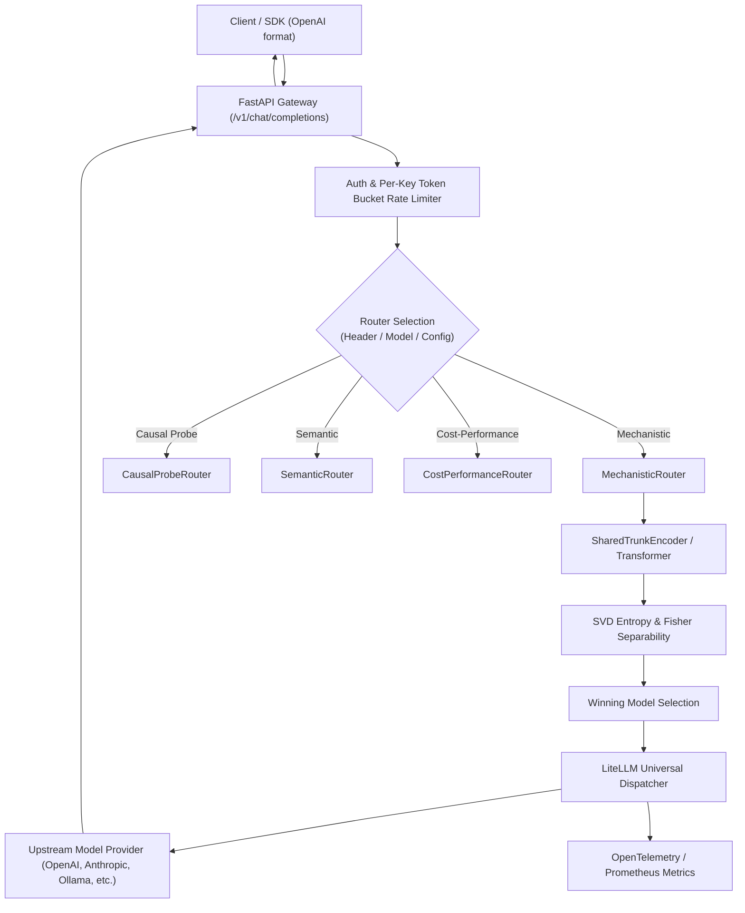

# Mechanistic LLM Router

> [!NOTE]
> **Architecture & Maturity Status:** The repository provides both an empirical causal probe router (`CausalProbeRouter`) with finite-sample Conformal Risk Control (`ConformalRiskController`) and counterfactual directional ablation (`CausalAblationHarness`), and a spectral/topological reference router (`MechanisticRouter` / `SimulatedRouter`). Empirical findings are documented in [`MECHANISTIC_SPIKE_REPORT.md`](MECHANISTIC_SPIKE_REPORT.md) and [`BENCHMARK_REPORT.md`](BENCHMARK_REPORT.md).

Welcome to the documentation for **Mechanistic LLM Router**, an open-source white-box routing engine and OpenAI-compatible API gateway investigating multi-model orchestration via **Encoder-Target Decoupling**, prefill activation inspection, Conformal Risk Control, and Sparse Autoencoder (SAE) cognitive circuit analysis.

---

## Key Highlights

- **Encoder-Target Decoupling**: Intercepts unpooled prefill activations $A \in \mathbb{R}^{S \times D}$ from a lightweight encoder to estimate query difficulty before invoking expensive frontier models.
- **Mechanistic & Statistical Signals**:
  - **Conformal Risk Control (`ConformalRiskController`)**: Finite-sample risk calibration ($\mathbb{E}[\ell] \le \alpha$) and binary Shannon entropy ($H_2(p)$) abstention across multi-tier model cascades.
  - **Linear Activation Probes & Causal Ablation**: Layer-wise probes (`LinearActivationProbe`) validated via counterfactual directional projection (`CausalAblationHarness`) against $K=50$ random subspace controls.
  - **Effective Dimensionality ($d_{\text{eff}}$) & Top-K SAE Circuits**: SVD spectrum entropy across representation layers and `SAEEngine` active circuit extraction.
  - **Fisher Discriminant ($J$)**: Evaluates candidate model separability across representation clusters.
- **Drop-in OpenAI Gateway**: FastAPI `/v1/chat/completions` REST and SSE server with token-bucket rate limiting, per-key concurrency locking, and payload size validation.
- **Universal Provider Dispatch**: Built on LiteLLM with exponential backoff retries across OpenAI, Anthropic, Bedrock, Vertex, and local Ollama/vLLM endpoints.
- **FinOps & OpenTelemetry Observability**: Real-time Prometheus metrics tracking router latency, endpoint latency deltas, and USD savings compared to frontier oracle models.
- **Rigorous Evaluation Harness**: Paired bootstrap confidence intervals (95% CI), prompt-disjoint splits, and Pareto frontier area-under-curve analysis.

---

## Architecture at a Glance

---

## Documentation Navigation

- **[Installation](getting-started/installation.md)**: Environment setup, virtual environments, dependencies, and Docker deployment.
- **[Quickstart](getting-started/quickstart.md)**: Python library walkthrough and running the OpenAI-compatible gateway.
- **[Architecture](architecture.md)**: Comprehensive deep-dive into mathematical foundations and system components.
- **[Causal Probing Guide](guides/causal-probe.md)**: Training linear probes on real transformer models (`SmolLM-135M`) and running causal ablation.
- **[RouterBench Evaluation](guides/routerbench.md)**: Downloading RouterBench and benchmarking against baseline policies.
- **[Baseline Record](BASELINE.md)**: Quality gates, empirical benchmarks, and label leakage inventory.
- **[Mechanistic Spike Report](MECHANISTIC_SPIKE_REPORT.md)**: Empirical report on transformer prefill probing and causal interventions.
- **[Benchmark Report](BENCHMARK_REPORT.md)**: Zero-leakage Pareto benchmark and paired bootstrap evaluation across routing policies.
