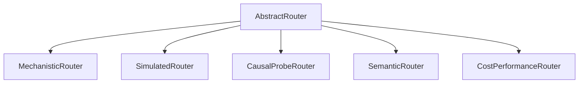

# Routers & Strategy Reference

All routing policies in the Mechanistic LLM Router adhere to the **Strategy Pattern** defined by the `AbstractRouter` interface.

---

## Strategy Hierarchy



---

## 1. `CausalProbeRouter`

**Module**: `mechanistic_router.routers.causal_probe`

The production routing strategy driven by residual-stream activations extracted from local open-weight language models (e.g., `SmolLM-135M`), evaluated against a trained `LinearActivationProbe`, and calibrated across multi-tier model pools via `ConformalRiskController`.

### Signature

```python
class CausalProbeRouter(AbstractRouter):
    def __init__(
        self,
        extractor: PrefillActivationExtractor,
        probe: LinearActivationProbe,
        model_pool: dict[str, TargetModel],
        config: RouterConfig = DEFAULT_CONFIG,
        threshold: float = 0.5,
        mid_threshold: float | None = None,
        conformal_controller: ConformalRiskController | None = None,
        max_uncertainty: float | None = None,
        cost_weight: float | None = None,
    ) -> None: ...
```

### Methods

- `route(request: RoutingRequest | str) -> RoutingDecision`: Evaluates prompt activation against the linear probe hyperplane and conformal risk thresholds.
- `calibrate_conformal(prompts: list[str], cheap_losses: list[float] | np.ndarray, mid_losses: list[float] | np.ndarray | None = None, alpha: float = 0.10) -> ConformalCalibrationSummary`: Calibrates finite-sample Conformal Risk Control thresholds on a validation split.
- `save_probe(filepath: str | Path) -> None`: Persists probe weights to a compressed `.npz` archive.
- `load_probe(filepath: str | Path) -> None`: Loads probe weights from a `.npz` archive into the router.
- `fit(prompts: list[str], labels: list[int] | np.ndarray) -> CausalProbeRouter`: Batch activation extraction and offline probe training.
- `from_saved_probe(...) -> CausalProbeRouter`: Factory method instantiating a router directly from a disk checkpoint.

---

## 2. `MechanisticRouter` / `SimulatedRouter`

**Module**: `mechanistic_router.routers.mechanistic`

A spectral and topological reference strategy computing Effective Dimensionality ($d_{\text{eff}}$) spectrum entropy over unpooled sequences, Fisher Discriminant separability ($J$), and Top-K Sparse Autoencoder (`SAEEngine`) feature circuit signals.

### Signature

```python
class MechanisticRouter(AbstractRouter):
    def __init__(
        self,
        encoder: AbstractEncoder,
        model_pool: dict[str, TargetModel],
        config: RouterConfig = DEFAULT_CONFIG,
        sae_engine: SAEEngine | None = None,
    ) -> None: ...


# Architectural alias
SimulatedRouter = MechanisticRouter
```

---

## 3. `SemanticRouter`

**Module**: `mechanistic_router.routers.semantic`

A deterministic embedding router classifying user prompts by calculating cosine similarity against domain intent centroids (e.g., balance inquiries, debt renegotiation, complex risk analysis).

### Signature

```python
class SemanticRouter(AbstractRouter):
    def __init__(
        self,
        model_pool: dict[str, TargetModel],
        config: RouterConfig = DEFAULT_CONFIG,
        embedding_fn: Callable[[str], np.ndarray] | None = None,
        centroids: dict[TaskComplexity, np.ndarray] | None = None,
    ) -> None: ...
```

Supports pluggable custom embedding functions (e.g., SentenceTransformers, OpenAI embeddings) or falls back to deterministic UTF-8 hash embeddings.

---

## 4. `CostPerformanceRouter`

**Module**: `mechanistic_router.routers.cost_performance`

A static baseline strategy selecting models based purely on static cost/accuracy trade-off parameter $\lambda$:

$$\text{score}(m) = \lambda \cdot \text{cost\_inv}(m) + (1 - \lambda) \cdot \text{acc}(m)$$

---

## 5. `LinUCBActivationRouter`

**Module**: `mechanistic_router.routers.linucb_probe`

Disjoint contextual bandit router operating over L2-normalized prefill activations with $O(D^2)$ rank-1 Sherman-Morrison inverse covariance updates.

---

## 6. `BatchPortfolioRouter` & `PrimalDualBudgetController`

**Module**: `mechanistic_router.routers.portfolio_optimizer`

Global FinOps portfolio optimizer solving multi-choice knapsack batch allocation and online Dual Mirror Descent shadow-price ($\mu_t$) updates under hard USD budget constraints.

---

## 7. `TopologicalDAGRouter`

**Module**: `mechanistic_router.routers.dag_router`

Multi-agent workflow DAG planner performing Kahn cycle detection, critical-path conformal $\alpha$-spending allocation, and exact Shapley value credit attribution.

---

## 8. `SpeculativeCascadeMonitor`

**Module**: `mechanistic_router.routers.speculative_cascade`

Mid-generation token-level negative log-likelihood (NLL) and epistemic hedging monitor with automatic mid-stream escalation to the frontier oracle.

---

## 9. `AbstractRouter`

**Module**: `mechanistic_router.routers.base`

Base abstract class establishing the asynchronous routing contract:

```python
class AbstractRouter(ABC):
    @abstractmethod
    async def route(self, request: RoutingRequest | str) -> RoutingDecision: ...
```

